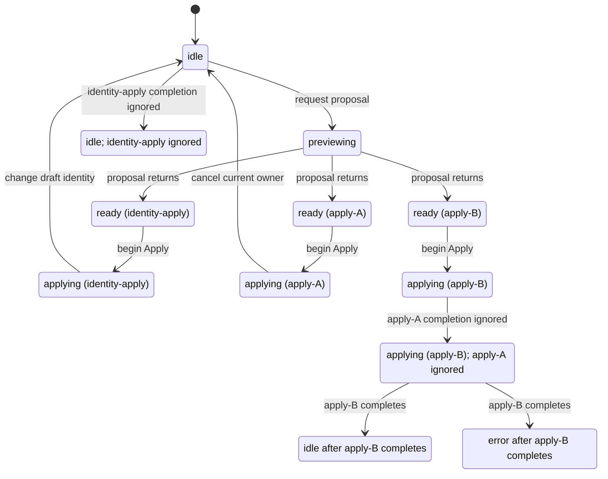

# Builder interaction formal verification and refinement

The output is better product code, not a green model or a larger test framework.
Use pstack `/maintain-formal-verification-skill` for model upkeep and `/statechart`
for every result. When the user asks for refinement, iteration, or "turning the
crank", that authorizes scoped, reversible product fixes; do not stop at a bug
report or ask again for routine permission. A verification-only request does not
by itself authorize product edits. Keep fixes separate from unrelated dirty work.

## Launch

Use the existing UI dependencies (`npm ci` from `ui` when absent). Fast verification launches Vitest's isolated Node/jsdom workers; no browser, database, token, deployed application, or formal tool download is required. Each run uses a fresh output directory. This is a component/function stand-in for the running UI, not browser acceptance. For formal checks, bootstrap the pinned tools as described below.

## Doctor

```sh
node scripts/verify-builder-formal-core.mjs --phase behavior --list
```

Require `ready-for-behavior-tests`. This read-only check verifies UI dependencies and assigns every remaining `src`/`testSupport` suite to exactly one feature. New unassigned or multiply assigned suites block. It does not health-check a deployed app. The existing live UI recipes live in `.codex/skills/verify` and `.codex/skills/verify-loom-ui`; local `verify` references retired browser helpers and must be repaired and proven before claiming a live pass.

## Drive

Read [features/README.md](features/README.md), then select the changed user behavior:

```sh
node scripts/verify-builder-formal-core.mjs --phase behavior --feature drafts --out /tmp/loom-draft-check
```

Features: `ownership`, `drafts`, `construction`, `tables`, `contracts`. `--case` accepts a Vitest name pattern for a narrower edit; a pattern that executes no assertions blocks. `--phase behavior --shard 1/4` selects one deterministic shard of all remaining UI suites, as CI does through Vitest. Run the focused feature while editing, the existing UI shards at checkpoints, and the formal audit when its covered boundaries change. Behavioral checks do not require or update formal source pins; they cannot establish that a changed model remains aligned.

## Restored thin browser checks

```sh
node scripts/verify-builder-formal-core.mjs --phase browser --list
node scripts/verify-builder-formal-core.mjs --phase browser --feature all --out /tmp/loom-browser-check
```

Requires installed UI build dependencies and a local Chromium executable (default `/usr/bin/chromium`, override `--chrome`). This compiles actual PreviewTable/OutputTable plus production CSS into an isolated loopback fixture. It drives trusted native drag/drop, checks stable row identity/order after component reload, and verifies exact configured download URLs, filenames, payload bytes and SHA across reload. The caller/sessionStorage and attachment HTTP response are test-owned; it is not a deployed Builder/Viewer or Loom persistence proof. `drag` and `download` select individual cases. Browser checks are opt-in checkpoints, not the default editing/Node CI loop. The worker records source fingerprints and observed state/screenshots; it stops its own Chromium/server/profile and preserves proof.

## Generated reconcile admission

`--model reconcile-acceptance --phase generated` checks the new `ReconcileAcceptance` input frontier through pstack statechart and replays every case on actual `authoring/reconcileAcceptance.ts`. The helper is the synchronous decoded-response decision after the caller's await/cancellation check; it preserves obsolete return, mismatch repair, compiled dispatch, and preview admission. It does not perform HTTP preview or prove React histories.

The frontier has 62,209 states/62,208 edges and 31,104 independent inputs: two owner/fingerprint identities, generations and snapshot tokens 0–2, optional requested output, every subset of three returned outputs, and absent/warning/error diagnostics. Owner/fingerprint renaming and every output ordering yield 248,832 real-code calls. Four branch promises each have actual model and production-source faults. `Inv_CurrentReceiptIsAdmitted` means admission, not that a preview was rendered. Inputs assume a valid decoded DTO. Replay witnesses with `node scripts/lib/formal-reconcile-replay.mjs --witness PATH`; broken code reproduces, current code holds, invalid/stale proof inputs block.

## Connected repository checks

```sh
node scripts/verify-builder-formal-core.mjs --phase inventory
node scripts/verify-builder-formal-core.mjs --phase api --list
node scripts/verify-builder-formal-core.mjs --phase api --feature restore
```

Inventory reports current CI execution routes for UI, Node, Python, shell, Go and formal checks, plus explicit excluded files/reasons. It does not execute tests or prove those routes. `node scripts/ci/list-node-tests.mjs --explain` names native Node checks and blocked dependency/fixture chains; incidental browser words do not exclude executable native checks.

Fast API features `restore`, `apply`, `receipts`, `route-roundtrip`, and `publication` run nine exact named public HTTP tests using production routes/services/compiler and test-owned repositories. The runner checks actual Go JSON run/pass events, rejects skipped/no-tests/error results, enforces 30-second child limits, and retains source fingerprints and process evidence under `api/`. Install the repository's exact Go version first; cold compilation can block the deadline and is setup work, never a passing check. `GO` may explicitly choose its executable. These fast cases use test-owned repository/materializer boundaries. Explicit `--phase api --feature route-rows` requires `LOOM_TEST_ARANGO_URL` for an owned Arango instance and exercises actual public API/compiler/query/storage: exact A→B→restored-A rows, IDs/CAS/history and fresh repository read-back in a private database. It creates/drops only its own UUID database. The fast `all` selection records this opt-in integration case as not run; it never converts an Arango skip into a pass. Neither profile proves a database-process restart or browser wiring.

Make shortcuts now execute checks: `make verify-fast VERIFY_FEATURE=drafts`, `make verify-api API_FEATURE=restore`, `make verify-formal`, and `make verify-inventory`. `make verify-full` is a Builder checkpoint (four UI shards, API groups and formal audit); full repository jobs remain in `.github/workflows/tests.yaml`. Retired browser journey commands fail explicitly.

## Evidence

Fresh `verification.json`, `behavior/behavior.json`, `behavior/vitest.json`, and `behavior/process.json` retain the input fingerprint, selected files, actual assertions, skipped names, failures, timing, and process output. Zero assertions, missing suites, tool errors, and deadlines block. Skipped tests produce `partial` coverage; they never become formal or live proof. Operation-history coverage now runs four self-contained UI/hook cases by default. Comprehensive-contract coverage runs seven bounded editor/client cases. External generated capture modes still require their own fixtures; these local cases do not prove the former generated inventory.

The feature map links each group to its production surface and applicable formal checks. A model link covers only its documented rules; it does not turn every test in that feature into a proof. No replacement of all deleted browser guarantees is claimed.

## Cleanup

Vitest workers terminate after each run; the runner kills its process group on timeout. It uses its own cache and clears mutation/capture settings. Delete only a run's `behavior/cache` when reclaiming space; retain reports and witnesses. No shared instance, project, Explorer, database, or credentials are modified. Confirm evidence still exists after workers exit. For the API recipe, the existing test owns an in-memory repository; it proves production HTTP/service behavior, not disk durability.

## Helpers

`node scripts/verify-builder-formal-core.mjs --phase behavior --list` is the doctor; the same entry point with `--feature` drives checks. `scripts/lib/formal-behavior.mjs` partitions and runs existing suites. Existing CI runs every UI shard and the retained native Node checks, including the authenticated UI helper tests; excluded legacy checks remain explicitly listed. Use pstack `/maintain-verification-skill` for this feature map and `/maintain-formal-verification-skill` for its model links.

## Turn the crank

1. **Choose a bounded promise.** Read the production functions and callers. Pick
   a costly failure where ordering matters; name its invariant, inputs, and
   schedule bounds. Existing model/driver code is a starting point, not evidence
   that the promise already holds.
2. **Explore and inspect.** Run the relevant command below. Use `/statechart` to
   interpret the shortest counterexample in application terms. Understand every
   atomic action and every await boundary before changing anything.
3. **Replay on real code.** Encode the path in a mounted hook/component schedule,
   capture real returns and observable state, and show it failing on unchanged
   product code. If the replay cannot happen, improve the abstraction/adapter;
   do not patch production to satisfy a fictional failure. Check caller reachability
   before claiming an end-to-end user incident.
4. **Refine the product.** For an authorized refinement task, make the smallest
   coherent fix and update every caller of an internal API that changed. Preserve
   the original reader rule. A verified bug report is an intermediate result.
5. **Check nearby schedules.** Turn ordering, success/failure, cancellation,
   duplicates, identity reuse, and one-field context changes into finite case
   families. Include positive cases: equivalent normalized identities must still
   work. Do not assume a receipt string identifies an execution attempt.
6. **Prove the fix is doing work.** Run the closest implementation regressions
   first. At a coherent checkpoint, run models, mounted trace checks, type checking,
   and source mutations. Remove the new guard in a scratch overlay; the matching
   real-code regression must fail by assertion, not tool/import/timeout error.
7. **Maintain the crank.** Update actions from the actual fix, source mappings,
   content pins, bounds, and diagram. Check for vacuous properties: there must be
   accepted and rejected observations for completion-context rules. If the model
   missed a real bug, repair its missing state/transition before claiming coverage.
8. **Turn again or close the bounded scope.** Expand the nearest risky interaction
   or choose the next uncovered promise. Stop only at a coherent reviewed patch,
   an exhausted stated scope, or a concrete blocker. Do not invent defects or make
   speculative product changes to keep producing patches.

A completed turn has a replayed failure, a product patch, passing regressions,
a caught reintroduced defect, and a model/diagram aligned to the fix. A framework
repair is useful when it removes a demonstrated blind spot; report it as such,
not as product quality improvement. On findings that remain, keep the tests red;
never use `it.fails`, weaken the invariant, or quarantine the repro to claim success.

## Run from the repository root

Requires Node 22.18+ (or 23.6+/24), Java 21, curl, Python 3, and installed UI dependencies (`npm ci` from `ui`). Bootstrap the hash-pinned TLC and upstream pstack statechart sources:

```sh
node scripts/setup-formal-tools.mjs
node scripts/verify-builder-formal-core.mjs --self-test --out /tmp/loom-formal-review
```

The default tool destination is `/tmp/loom-formal-tools`. Setup also accepts `--out`, `--archive`, and `--jar` for verified offline artifacts; export the printed `PSTACK_STATECHART_ROOT` and `TLA2TOOLS_JAR` when using another destination. `tools.lock.json` pins both downloads and the complete upstream scripts tree. Follow pstack `/statechart` for its current interactive invocation; the runner imports its pinned programmatic compiler and never duplicates its CLI.

Use fresh output directories. Normal execution checks models, generated production-code transitions, and mounted React traces. `--self-test` adds every model control, every real-source proof, trace-reader controls, and type checking. `--models-only` is an explicit diagnostic shortcut, not code verification. Select `--model lifecycle|reconcile|apply-settlement` or `--phase models|implementation|generated|controls|source-proofs|trace-controls`; control phases accept `--shard N/M`. Every Java/Vitest proof subprocess has a 30-second deadline; the complete audit is a batch, not a 30-second command. CI shards the batch under a ten-minute job limit. Tool, parse, import, drift, missing dependency, and timeout errors block verification; they never count as caught mutants. Evidence remains in the printed output directory even without `--out`.

## Executable pipeline

- `useConstructionLifecycle.formal.test.tsx` mounts the production hook and React
  subscriptions with deferred transports. Its finite families exercise response
  order/mismatches, replacement, explicit cancel, retry, ABA, Apply callback order,
  duplicate completions, reused receipts, and workspace context changes.
- `BuilderWorkspace.reconciliation.unit.test.tsx` mounts the actual workspace.
  The A/B race uses the real reconcile hook/client and deferred HTTP responses;
  draft/output/receipt observations come from DOM attributes. Other UI/API fixtures
  are mocked. Two receipt mismatch tests exercise the actual workspace callback
  with mocked mutation transport. They are not backend or browser acceptance.
- `testSupport/formalTrace.ts` records actual hook/DOM state, input context,
  initiating attempt, and completion return values. The adapter lowers these facts
  into a small observation record. It distinguishes attempts from receipt IDs and
  normalizes authorization whitespace the same way as the production identity.
- `ImplementationConformance.tla` checks reader rules along these real traces,
  including unchanged visible state for ignored callers and matching current
  context when a completion claims ownership. This is trace safety, not full
  refinement against every transition of the abstract models.
- `ApplySettlementRace` is lowered through upstream DOT → IR into explicit action inputs. Every edge is replayed from a shortest representative prefix against the production `constructionApplyOwnership.ts` component. `SetCurrentOwner` supplies the live identity reader; it does not pretend an HTTP/React round trip is atomic. This is complete edge coverage of the bounded abstraction, not all histories of JavaScript execution. Independent finite identity inputs cover owner, request key, generation, outcomes, and duplicates.
- `BuilderLifecycle` and `ReconcileLifecycle` are broader design abstractions linked to actual hook/workspace probes and source mutations. They do not have complete generated React transition refinement. Each declared behavioral property must have both a model control and a real-source proof; the runner checks inventory equality. TypeOK checks the schema.
- Reconcile response snapshot/output/errors are independent external inputs. Receipt fields denote a new acceptance event, not the reducer's retained receipt. Failure may retain an old stored receipt; it must not accept a new preview. Matching the submitted request does not prove it matches an independently changed latest catalog.
- Run installed pstack `/statechart` on generated trace models with
  `verification/builder-interactions/statechart.view.mjs`. Its compiler parses
  TLC/SANY and graph output, lowers to graph IR, annotates bugs/shortest paths,
  and emits Mermaid. Reuse that pipeline; do not build another parser or renderer.
  Follow `/statechart` for its current invocation instead of copying its CLI here.

`--out` preserves fresh traces, Vitest results, and self-contained generated
TLA/config before checking, including on a bug. Keep expanded reports outside Git.
Content fingerprints are checked before/after execution, headers must match the
run, and empty, unsupported, or stale evidence fails closed. Controls exercise
those rejection paths. Completion properties require accepted and rejected cases;
a pass that never exercises its antecedent is not sufficient evidence.

## Refinements completed in this working tree

| Turn | Counterexample on real code | Product refinement | Retained proof |
| --- | --- | --- | --- |
| Apply attempt ownership | Apply A → cancel → Apply B → A returns; A cleared B or marked it error | `beginApply` returns `{ proposalId, finish }` closing over a unique attempt. Old/duplicate handles cannot release or settle a later attempt. Workspace cleanup uses the ownership result. | Success/failure × old/current completion order × reused/distinct receipt IDs, plus duplicate callback checks; removing the handle guard fails real tests |
| Current editor ownership | After the first fix, change any one of nine context fields before completion; it still reported ownership of the current editor | Completion also checks current request identity/generation. The workspace closes/resets an editor only for a completion that still owns it. | Eighteen failing cases became passing regressions; removing the context guard fails again. Equivalent authorization formatting remains accepted |

These are hook/callback boundary refinements, not proof of a production UI incident.
The workspace also gates Apply while commands are pending. The complete retained
workspace suite passes; full browser, persistence, and CDA acceptance was not run.

The current diagram below is generated by pstack from four **fixed-code** schedules:
two old-first cancel/reapply outcomes and two output-context-change outcomes.
It covers 32 observed states/28 steps projected to 12 states/13 arrows. It is not
the full abstract graph; other schedules are excluded and self-label steps may
be hidden by the projection. The old callback now leaves B applying, and only
B's completion can finish B.



## Source mappings and reviewed baseline

Original sync baseline: `5646633e0e5c7ff8de568a4f111478d121e7f75f`.
The runner pins seven production files, including the **reviewed, uncommitted** Apply-handle/context fixes and extracted synchronous ownership component. `reviewed-sources.json` records the reviewed working-tree hashes and original baseline. Do not invent a new sync commit for an uncommitted patch. A hash
failure means review required, not a proved product defect. Never update a hash
alone: read the change, update its model/driver, and replay/control the promise.

All UI feature paths below start under `ui/packages/loom-ui/src/features/ExplorerBuilder/`.

| Boundary | Production symbols | Model/replay |
| --- | --- | --- |
| Reviewed preview gating | `constructionWorkspace/useConstructionLifecycle.ts`: `previewMatchesProposal`, `beginApply`; `ConstructionProposalPanel.tsx`: `constructionProposalIsApplicable` | `BuilderLifecycle`, mounted mismatch/order cases, trace readiness rules |
| Apply settlement and editor cleanup | `constructionWorkspace/constructionApplyOwnership.ts`: `beginConstructionApply`; same hook: `beginApply` returned `finish`, `cancel`; `BuilderWorkspace.tsx`: `applyConstructionProposal` | `ApplySettlementRace`, generated callback/context schedules, attempt/context source mutations |
| Stale proposal/discovery ownership | Same hook: generation/owner refs, `pivotDiscoveryLoadIdentity`, `capabilitiesIdentity`, `onDiscoverCategories`; `ui/packages/loom-ui/src/react.tsx`: `resourceFor` | Lifecycle generation/identity rules and retained real-hook cases |
| Reconcile acceptance and retry | `BuilderWorkspace.tsx`: `reconcileCurrent`; `authoring/reconcileRecovery.ts`: current-result/receipt/recovery predicates | `ReconcileLifecycle`, generated `ReconcileAcceptance` helper replay, mounted workspace races, receipt callback tests and bounded predicates |
| Backend discovery boundary | `internal/explorer/lifecycle/construction_category_discovery.go`: receipt/stage checks | Abstract identity assumption only; no new backend conformance claim |

## Bounds, controls, and limits

- `BuilderLifecycle`: A/B identities, proposal/discovery generations 0–2, one represented slot per request type; 8,073 states. A brief A→B→A before cleanup may reuse its owner.
- `ApplySettlementRace`: two distinct owners, pending callbacks, two contexts, success/failure; 2,511 states. Actions map to synchronous inputs and ownership operations. Repeated and duplicate real completions also have independent input checks and mounted tests.
- `ReconcileLifecycle`: A/B, generations/snapshot/output 0–2, two retries/two stale refreshes, shared total budget; 150,841 states. Inactive event payloads are quotiented away, not constrained external responses.
- Seventeen behavioral model rules have exact named negative controls. Real-source proofs require the corresponding assertion/property failure on broken source and a restored pass; syntax/import/timeouts are rejected. Some rules have multiple source mutations for distinct guard dimensions. `trace-obligations.json` maps seven observation rules to real-code proofs; trace-reader perturbations separately check the adapter.
- Every result passes through upstream pstack statechart compilation. Graphs exceeding its 500-state diagram budget legitimately have no full chart. Mounted traces additionally emit a greedy representative passing trace diagram and `diagram-scope.json`; it is not the full explored graph. Counterexamples retain their actual path and labeled failing state. Unknown action labels fail closed.
- Safety only: configs disable deadlock checking. No fairness/liveness, full React refinement, browser/layout, persistence, backend/FHIR semantics, or replacement of removed acceptance coverage is claimed. The recorded React schedules are finite real-code samples. The new decoded-response admission frontier is generated-code coverage of its stated inputs, not complete React refinement.

## Replay a counterexample

```sh
node scripts/lib/formal-apply-replay.mjs --witness /tmp/loom-formal-review/statecharts/NUMBER-ApplySettlementRace/result.json
```

This accepts an Apply statechart result containing counterexamples or a saved source-proof `counterexample.json`. Source-proof witnesses also retain exact generated identity inputs (including generation-only failures). Optional final argument: a scratch copy of the production ownership source. It validates actors/actions/outcomes, invokes real code, and prints `reproduced` (exit 1) or `property-held` (exit 0). Invalid input blocks. `property-held` means this recorded input path did not reproduce the named bug; it is not a full verification pass. Unexpected Apply model failures automatically preserve this production replay classification beside the statechart result. Generated replay failures retain their shortest representative input path. A model-control counterexample must hold on correct code and fail on the corresponding broken source before claiming the adapter can find that defect.

Reconcile generated predicate proofs retain their exact identity, receipt, or retry inputs with independently computed expected/actual values. Replay them with:

```sh
node scripts/lib/formal-source-proof-worker.mjs --witness /tmp/loom-formal-review/source-proofs/10-Inv_AcceptedReceiptIsCurrent/counterexample.json
```

The optional final argument supplies scratch broken `reconcileRecovery.ts` source. Exit/status meanings match Apply replay. All generated source proofs must retain a counterexample or the audit blocks.

## Maintain and review

The reconcile abstraction was corrected from source: the old `Inv_NoReceiptOutsideSuccess` storage claim became `Inv_NoNewAcceptanceOnFailure`, because `authoring/reducer.ts` retains the previous receipt during compiling/repair. The old `Inv_AcceptedReceiptMatchesCurrentVersions` claim became `Inv_ReceiptSelectsRequestedOutput` alongside request-snapshot matching, because `BuilderWorkspace.reconcileCurrent` and `reconcileRecovery.reconcileReceiptMatchesRequest` compare the returned receipt to submitted request values. These were modeling errors, not changes to the product promise or reduced input bounds. No latest-catalog guarantee is claimed.

Before changing code, run the applicable area and inspect changes against the recorded baseline and reviewed hashes. Classify failures as product bugs, abstraction drift, or blocked tools. Read actual callers and awaits; preserve failing promises, fix confirmed reachable defects, and keep product and verification patches separately reviewable. Never update hashes alone. Restore source after deliberate mutation (the supplied overlay runner never edits live files), rerun the proof, then run the complete audit. Report `refined`, `crank improved`, `finding remains`, or `blocked`, with concrete evidence and limits.

At closure use pstack `/interrogate`: two configured independent reviewers, each with its own copy of the dirty scope; executable findings only; rerun every finding yourself. A passing diagram or reviewer opinion alone is insufficient.

## Refinements from recovered coverage

- Artifact preparation previously accepted shape-valid responses for foreign project/Explorer/revision/output and exposed a download. The actual client now checks canonical project and exact requested identity. All 16 matching/foreign dimension combinations, four project aliases, and mounted export cases protect this promise; removing the guard reproduces the failure.
- FileCell appended UUIDs after configured query strings. The actual URL builder now preserves path, query and fragment separately, encodes the ID and emits `redirect=true` once. Component and native-browser download tests catch reintroduced bad construction.
- Restored real Arango checks exposed missing/null conflation in exclusion diagnostics and duplicate-ID cohort lookups selecting filtered-out resource copies. Diagnostic presence and surviving-contributor selection were corrected with unchanged literal Arango oracles; fixture-only project/identity drift is reported separately.

The two Viewer/client predicate regressions are labeled `Behavior` source proofs, not TLA model invariants. Keep actual renderer/API source-fault checks and the real browser/database boundary explicit. See `docs/verification/RETAINED_COVERAGE_DECISIONS.md` for recovered versus remaining guarantees.

## Backend checkpoint and external profiles

`.github/workflows/tests.yaml` now exercises actual Arango in a dedicated service job through `scripts/run-arango-integration.mjs`. With `LOOM_TEST_ARANGO_URL` pointing to an explicitly owned unauthenticated instance, run `node scripts/run-arango-integration.mjs --out /tmp/loom-arango-check`. The driver creates isolated databases, refuses to adopt an existing fixed fixture database, enables required C01/SC02 fixture profiles, requires actual named run/pass events, rejects unexpected skips, records source fingerprints and drops only databases it created. Compilation setup is separate from runtime proof. Six external workload/opt-in cases remain explicitly unverified; ordinary unit cases in the store profile are not mislabeled as a real store witness (the route profile supplies actual repository proof).

Catalog's 157,892 template witnesses are checked completely across four deterministic CI partitions using `LOOM_CATALOG_WITNESS_SHARD=N/4`; malformed/empty selections block. Ordinary Go jobs skip this one expensive function because the dedicated catalog matrix runs every assigned case. No witness assertions or bounds were removed. On the two-core checkpoint each partition takes about 13–14 seconds; concurrent whole-repository jobs on one machine can cause misleading contention timeouts. ClickHouse remains its own real-service CI job. Full-CDA read-only probing requires its genuine preseeded dataset/index and is opt-in, never satisfied by substituting a small synthetic fixture.
