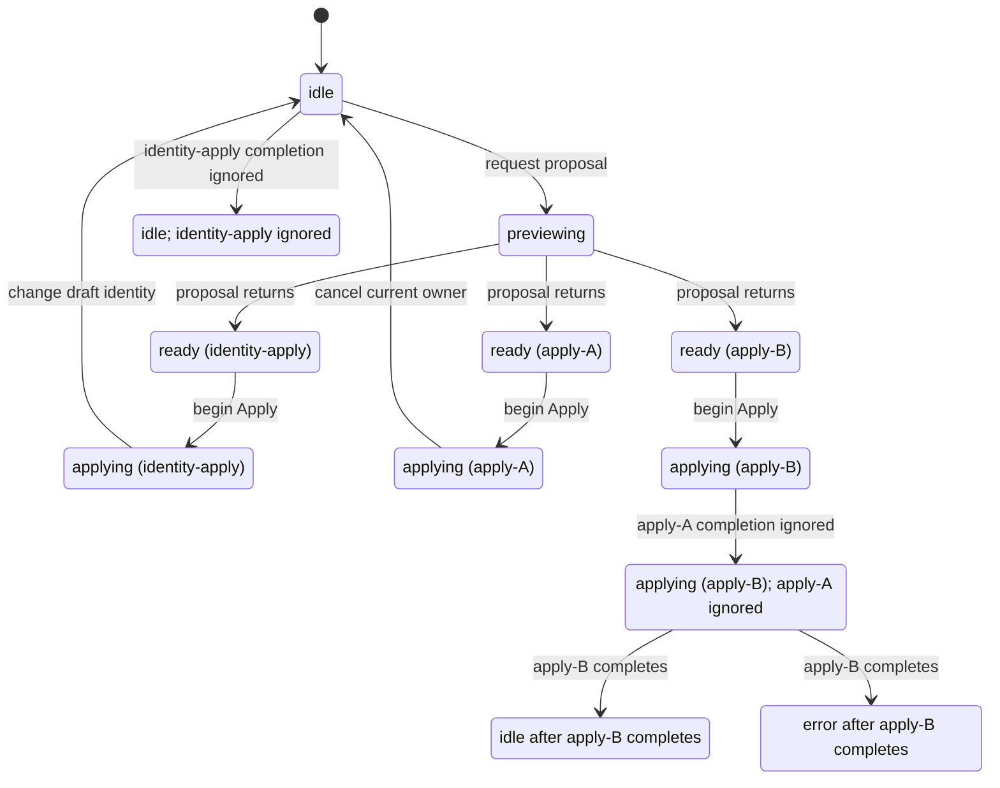

# Builder interaction formal verification and refinement

The output is better product code, not a green model or a larger test framework.
Use pstack `/maintain-formal-verification-skill` for model upkeep and `/statechart`
for every result. When the user asks for refinement, iteration, or "turning the
crank", that authorizes scoped, reversible product fixes; do not stop at a bug
report or ask again for routine permission. A verification-only request does not
by itself authorize product edits. Keep fixes separate from unrelated dirty work.

## Launch

Use the existing UI dependencies (`npm ci` from `ui` when absent). Fast verification launches Vitest's isolated Node/jsdom workers; no browser, database, token, deployed application, or formal tool download is required. Each run uses a fresh output directory. This is a component/function stand-in for the running UI, not browser acceptance. For formal checks, bootstrap the pinned tools as described below.

## Doctor

```sh
node scripts/verify-builder-formal-core.mjs --phase behavior --list
```

Require `ready-for-behavior-tests`. This read-only check verifies UI dependencies and assigns every remaining `src`/`testSupport` suite to exactly one feature. New unassigned or multiply assigned suites block. It does not health-check a deployed app. The existing live UI recipes live in `.codex/skills/verify` and `.codex/skills/verify-loom-ui`; local `verify` references retired browser helpers and must be repaired and proven before claiming a live pass.

## Drive

Read [features/README.md](features/README.md), then select the changed user behavior:

```sh
node scripts/verify-builder-formal-core.mjs --phase behavior --feature drafts --out /tmp/loom-draft-check
```

Features: `ownership`, `drafts`, `construction`, `tables`, `contracts`, `core-protocol`. The [core protocol operation map](core-protocol.md) records callers, identities and awaited boundaries for the composed save/reconcile/preview flow. `--case` accepts a Vitest name pattern for a narrower edit; a pattern that executes no assertions blocks. `--phase behavior --shard 1/4` remains an optional local partition. CI runs the complete unsharded suite. Run a focused feature while editing and the full suite at checkpoints, and the formal audit when its covered boundaries change. A failing or failing-revealed run follows the first-failure-capture rule in `../verify/SKILL.md`: preserve evidence, capture the complete log plus exit code once, diagnose the first actionable failure, then rerun only the smallest relevant check; never rerun a broad phase to reveal error output, and never the full suite for one tiny change. Behavioral checks do not require or update formal source pins; they cannot establish that a changed model remains aligned.

## Restored thin browser checks

```sh
node scripts/verify-builder-formal-core.mjs --phase browser --list
node scripts/verify-builder-formal-core.mjs --phase browser --feature all --out /tmp/loom-browser-check
```

Requires installed UI build dependencies and a local Chromium executable (default `/usr/bin/chromium`, override `--chrome`). This compiles actual PreviewTable/OutputTable plus production CSS into an isolated loopback fixture. It drives trusted native drag/drop, checks stable row identity/order after component reload, and verifies exact configured download URLs, filenames, payload bytes and SHA across reload. The caller/sessionStorage and attachment HTTP response are test-owned; it is not a deployed Builder/Viewer or Loom persistence proof. `drag` and `download` select individual cases. Browser checks are opt-in checkpoints, not the default editing/Node CI loop. The worker records source fingerprints and observed state/screenshots; it stops its own Chromium/server/profile and preserves proof.

## Generated reconcile admission

`--model reconcile-acceptance --phase generated` checks the new `ReconcileAcceptance` input frontier through pstack statechart and replays every case on actual `authoring/reconcileAcceptance.ts`. The helper is the synchronous decoded-response decision after the caller's await/cancellation check; it preserves obsolete return, mismatch repair, compiled dispatch, and preview admission. It does not perform HTTP preview or prove React histories.

The frontier has 62,209 states/62,208 edges and 31,104 independent inputs: two owner/fingerprint identities, generations and snapshot tokens 0–2, optional requested output, every subset of three returned outputs, and absent/warning/error diagnostics. Owner/fingerprint renaming and every output ordering yield 248,832 real-code calls. Four branch promises each have actual model and production-source faults. `Inv_CurrentReceiptIsAdmitted` means admission, not that a preview was rendered. Inputs assume a valid decoded DTO. Replay witnesses with `node scripts/lib/formal-reconcile-replay.mjs --witness PATH`; broken code reproduces, current code holds, invalid/stale proof inputs block.

## Connected repository checks

```sh
node scripts/verify-builder-formal-core.mjs --phase inventory
node scripts/verify-builder-formal-core.mjs --phase api --list
node scripts/verify-builder-formal-core.mjs --phase api --feature restore
```

Inventory reports current CI execution routes for UI, Node, Python, shell, Go and formal checks, plus explicit excluded files/reasons. It does not execute tests or prove those routes. `node scripts/ci/list-node-tests.mjs --explain` names native Node checks and blocked dependency/fixture chains; incidental browser words do not exclude executable native checks.

Fast API features `restore`, `apply`, `receipts`, `route-roundtrip`, and `publication` run nine exact named public HTTP tests using production routes/services/compiler and test-owned repositories. The runner checks actual Go JSON run/pass events, rejects skipped/no-tests/error results, uses focused 30-second local limits and ten-minute CI limits, and retains source fingerprints and process evidence under `api/`. Install the repository's exact Go version first; cold compilation can block the deadline and is setup work, never a passing check. `GO` may explicitly choose its executable. These fast cases use test-owned repository/materializer boundaries. Explicit `--phase api --feature route-rows` requires `LOOM_TEST_ARANGO_URL` for an owned Arango instance and exercises actual public API/compiler/query/storage: exact A→B→restored-A rows, IDs/CAS/history and fresh repository read-back in a private database. It creates/drops only its own UUID database. The fast `all` selection records this opt-in integration case as not run; it never converts an Arango skip into a pass. Neither profile proves a database-process restart or browser wiring.

Make shortcuts now execute checks: `make verify-fast VERIFY_FEATURE=drafts`, `make verify-api API_FEATURE=restore`, `make verify-formal`, and `make verify-inventory`. `make verify-full` is a Builder checkpoint (one complete UI run, API groups and formal audit); full repository jobs remain in `.github/workflows/tests.yaml`. Retired browser journey commands fail explicitly.

## Evidence

Fresh `verification.json`, `behavior/behavior.json`, `behavior/vitest.json`, and `behavior/process.json` retain the input fingerprint, selected files, actual assertions, skipped names, failures, timing, and process output. Zero assertions, missing suites, tool errors, and deadlines block. Skipped tests produce `partial` coverage; they never become formal or live proof. Operation-history coverage now runs five self-contained UI/hook cases by default. Comprehensive-contract coverage runs seven bounded editor/client cases. External generated capture modes still require their own fixtures; these local cases do not prove the former generated inventory.

The feature map links each group to its production surface and applicable formal checks. A model link covers only its documented rules; it does not turn every test in that feature into a proof. No replacement of all deleted browser guarantees is claimed.

## Cleanup

Vitest workers terminate after each run; the runner kills its process group on timeout. It uses its own cache and clears mutation/capture settings. Delete only a run's `behavior/cache` when reclaiming space; retain reports and witnesses. No shared instance, project, Explorer, database, or credentials are modified. Confirm evidence still exists after workers exit. For the API recipe, the existing test owns an in-memory repository; it proves production HTTP/service behavior, not disk durability.

## Helpers

`node scripts/verify-builder-formal-core.mjs --phase behavior --list` is the doctor; the same entry point with `--feature` drives checks. `scripts/lib/formal-behavior.mjs` partitions and runs existing suites. Existing CI runs complete unsharded UI and native Node suites, including the authenticated UI helper tests; excluded legacy checks remain explicitly listed. Use pstack `/maintain-verification-skill` for this feature map and `/maintain-formal-verification-skill` for its model links.

## Turn the crank

1. **Choose a bounded promise.** Read the production functions and callers. Pick
   a costly failure where ordering matters; name its invariant, inputs, and
   schedule bounds. Existing model/driver code is a starting point, not evidence
   that the promise already holds.
2. **Explore and inspect.** Run the relevant command below. Use `/statechart` to
   interpret the shortest counterexample in application terms. Understand every
   atomic action and every await boundary before changing anything.
3. **Replay on real code.** Encode the path in a mounted hook/component schedule,
   capture real returns and observable state, and show it failing on unchanged
   product code. If the replay cannot happen, improve the abstraction/adapter;
   do not patch production to satisfy a fictional failure. Check caller reachability
   before claiming an end-to-end user incident.
4. **Refine the product.** For an authorized refinement task, make the smallest
   coherent fix and update every caller of an internal API that changed. Preserve
   the original reader rule. A verified bug report is an intermediate result.
5. **Check nearby schedules.** Turn ordering, success/failure, cancellation,
   duplicates, identity reuse, and one-field context changes into finite case
   families. Include positive cases: equivalent normalized identities must still
   work. Do not assume a receipt string identifies an execution attempt.
6. **Prove the fix is doing work.** Run the closest implementation regressions
   first. At a coherent checkpoint, run models, mounted trace checks, type checking,
   and source mutations. Remove the new guard in a scratch overlay; the matching
   real-code regression must fail by assertion, not tool/import/timeout error.
7. **Maintain the crank.** Update actions from the actual fix, source mappings,
   content pins, bounds, and diagram. Check for vacuous properties: there must be
   accepted and rejected observations for completion-context rules. If the model
   missed a real bug, repair its missing state/transition before claiming coverage.
8. **Turn again or close the bounded scope.** Expand the nearest risky interaction
   or choose the next uncovered promise. Stop only at a coherent reviewed patch,
   an exhausted stated scope, or a concrete blocker. Do not invent defects or make
   speculative product changes to keep producing patches.

A completed turn has a replayed failure, a product patch, passing regressions,
a caught reintroduced defect, and a model/diagram aligned to the fix. A framework
repair is useful when it removes a demonstrated blind spot; report it as such,
not as product quality improvement. On findings that remain, keep the tests red;
never use `it.fails`, weaken the invariant, or quarantine the repro to claim success.

## Run from the repository root

Requires Node 22.18+ (or 23.6+/24), Java 21, Go 1.26.5, curl, Python 3, and installed UI dependencies (`npm ci` from `ui`). Bootstrap the hash-pinned TLC and upstream pstack statechart sources:

```sh
node scripts/setup-formal-tools.mjs
node scripts/verify-builder-formal-core.mjs --self-test --out /tmp/loom-formal-review
```

The default tool destination is `/tmp/loom-formal-tools`. Setup also accepts `--out`, `--archive`, and `--jar` for verified offline artifacts; export the printed `PSTACK_STATECHART_ROOT` and `TLA2TOOLS_JAR` when using another destination. `tools.lock.json` pins both downloads and the complete upstream scripts tree. Follow pstack `/statechart` for its current interactive invocation; the runner imports its pinned programmatic compiler and never duplicates its CLI.

Use fresh output directories. Normal execution checks models, generated production-code transitions, and mounted React traces. `--self-test` adds every model control, every real-source proof, trace-reader controls, and type checking. `--models-only` is an explicit diagnostic shortcut, not code verification. Select `--model lifecycle|reconcile|apply-settlement` or `--phase models|implementation|generated|controls|source-proofs|trace-controls`; control phases accept `--shard N/M`. Focused local Java/Vitest proof subprocesses default to 30 seconds. CI runs the complete unsharded audit with ten-minute child budgets and a ten-minute job limit; no control phase matrices are required. `scripts/lib/verification-budget.mjs` centralizes that distinction. Tool, parse, import, drift, missing dependency, and timeout errors block verification; they never count as caught mutants. Evidence remains in the printed output directory even without `--out`.

## Executable pipeline

- `useConstructionLifecycle.formal.test.tsx` mounts the production hook and React
  subscriptions with deferred transports. Its finite families exercise response
  order/mismatches, replacement, explicit cancel, retry, ABA, Apply callback order,
  duplicate completions, reused receipts, and workspace context changes.
- `BuilderWorkspace.reconciliation.unit.test.tsx` mounts the actual workspace.
  The A/B race uses the real reconcile hook/client and deferred HTTP responses;
  draft/output/receipt observations come from DOM attributes. Other UI/API fixtures
  are mocked. Two receipt mismatch tests exercise the actual workspace callback
  with mocked mutation transport. They are not backend or browser acceptance.
- `testSupport/formalTrace.ts` records actual hook/DOM state, input context,
  initiating attempt, and completion return values. The adapter lowers these facts
  into a small observation record. It distinguishes attempts from receipt IDs and
  normalizes authorization whitespace the same way as the production identity.
- `ImplementationConformance.tla` checks reader rules along these real traces,
  including unchanged visible state for ignored callers and matching current
  context when a completion claims ownership. This is trace safety, not full
  refinement against every transition of the abstract models.
- `ApplySettlementRace` is lowered through upstream DOT → IR into explicit action inputs. Every edge is replayed from a shortest representative prefix against the production `constructionApplyOwnership.ts` component. `SetCurrentOwner` supplies the live identity reader; it does not pretend an HTTP/React round trip is atomic. This is complete edge coverage of the bounded abstraction, not all histories of JavaScript execution. Independent finite identity inputs cover owner, request key, generation, outcomes, and duplicates.
- `BuilderLifecycle` and `ReconcileLifecycle` are broader design abstractions linked to actual hook/workspace probes and source mutations. They do not have complete generated React transition refinement. Each declared behavioral property must have both a model control and a real-source proof; the runner checks inventory equality. TypeOK checks the schema.
- Reconcile response snapshot/output/errors are independent external inputs. Receipt fields denote a new acceptance event, not the reducer's retained receipt. Failure may retain an old stored receipt; it must not accept a new preview. Matching the submitted request does not prove it matches an independently changed latest catalog.
- Run installed pstack `/statechart` on generated trace models with
  `verification/builder-interactions/statechart.view.mjs`. Its compiler parses
  TLC/SANY and graph output, lowers to graph IR, annotates bugs/shortest paths,
  and emits Mermaid. Reuse that pipeline; do not build another parser or renderer.
  Follow `/statechart` for its current invocation instead of copying its CLI here.

`--out` preserves fresh traces, Vitest results, and self-contained generated
TLA/config before checking, including on a bug. Keep expanded reports outside Git.
Content fingerprints are checked before/after execution, headers must match the
run, and empty, unsupported, or stale evidence fails closed. Controls exercise
those rejection paths. Completion properties require accepted and rejected cases;
a pass that never exercises its antecedent is not sufficient evidence.

## Refinements completed in this working tree

| Turn | Counterexample on real code | Product refinement | Retained proof |
| --- | --- | --- | --- |
| Apply attempt ownership | Apply A → cancel → Apply B → A returns; A cleared B or marked it error | `beginApply` returns `{ proposalId, finish }` closing over a unique attempt. Old/duplicate handles cannot release or settle a later attempt. Workspace cleanup uses the ownership result. | Success/failure × old/current completion order × reused/distinct receipt IDs, plus duplicate callback checks; removing the handle guard fails real tests |
| Current editor ownership | After the first fix, change any one of nine context fields before completion; it still reported ownership of the current editor | Completion also checks current request identity/generation. The workspace closes/resets an editor only for a completion that still owns it. | Eighteen failing cases became passing regressions; removing the context guard fails again. Equivalent authorization formatting remains accepted |

These are hook/callback boundary refinements, not proof of a production UI incident.
The workspace also gates Apply while commands are pending. The complete retained
workspace suite passes; full browser, persistence, and CDA acceptance was not run.

The current diagram below is generated by pstack from four **fixed-code** schedules:
two old-first cancel/reapply outcomes and two output-context-change outcomes.
It covers 32 observed states/28 steps projected to 12 states/13 arrows. It is not
the full abstract graph; other schedules are excluded and self-label steps may
be hidden by the projection. The old callback now leaves B applying, and only
B's completion can finish B.



## Source mappings and reviewed baseline

Maintenance at `dc9016bc9080596099c1ad0253ea3ee229544c58` on 2026-10-31 is **blocked**, not a new sync. All 29 reviewed source hashes match. The eleven models, their model controls, generated production replays and mounted trace checks passed. Seventeen source-proof records completed with positive/negative controls before `Inv_GroupKeyCascadePreservesIndependentCalculate` exceeded the 30-second local limit. Timeout cleanup additionally assumed Linux `/proc`, which is absent on macOS. The combined audit did not finish its remaining source proofs, trace controls or type check; service/browser profiles were not selected. No current product counterexample was established. Keep the sync commit below unchanged. On a new host, bootstrap pinned tools and set `GO` to the actual compatible binary; verify it under `GOTOOLCHAIN=local` before running. Earlier references below to uncommitted work describe preparation before `dc9016bc9` committed those changes.

Original sync baseline: `5646633e0e5c7ff8de568a4f111478d121e7f75f`.
The runner pins the production files listed in `reviewed-sources.json`, including the unchanged authoring model helpers used by direct recovery replay. Apply-handle/context fixes and synchronous acceptance extraction were committed in `e736e1300716e8cdfe4dbfbe370e87b6713bebd2`. The current reviewed working tree adds recovery ownership gates across real refresh/backoff awaits. `reviewed-sources.json` records that committed baseline plus reviewed uncommitted hashes. Do not invent a new sync commit for an uncommitted patch. A hash
failure means review required, not a proved product defect. Never update a hash
alone: read the change, update its model/driver, and replay/control the promise.

All UI feature paths below start under `ui/packages/loom-ui/src/features/ExplorerBuilder/`.

| Boundary | Production symbols | Model/replay |
| --- | --- | --- |
| Reviewed preview gating | `constructionWorkspace/useConstructionLifecycle.ts`: `previewMatchesProposal`, `beginApply`; `ConstructionProposalPanel.tsx`: `constructionProposalIsApplicable` | `BuilderLifecycle`, mounted mismatch/order cases, trace readiness rules |
| Apply settlement and editor cleanup | `constructionWorkspace/constructionApplyOwnership.ts`: `beginConstructionApply`; same hook: `beginApply` returned `finish`, `cancel`; `BuilderWorkspace.tsx`: `applyConstructionProposal` | `ApplySettlementRace`, generated callback/context schedules, attempt/context source mutations |
| Stale proposal/discovery ownership | Same hook: generation/owner refs, `pivotDiscoveryLoadIdentity`, `capabilitiesIdentity`, `onDiscoverCategories`; `ui/packages/loom-ui/src/react.tsx`: `resourceFor` | Lifecycle generation/identity rules and retained real-hook cases |
| Reconcile acceptance and retry | `BuilderWorkspace.tsx`: `reconcileCurrent`; `authoring/reconcileRecovery.ts`: current-result/receipt/recovery predicates | `ReconcileLifecycle`, generated `ReconcileAcceptance` helper replay, await-split `ReconcileRefresh`, mounted workspace races, receipt callback tests and bounded predicates |
| Ordinary construction lineage | `internal/explorer/authoringv2/construction.go`: `Construction.Validate`; `construction_validation.go`: `constructionStepInputSchema` | `ConstructionChain`, actual public Go validator and predecessor reference/schema faults |
| Population coverage report | `internal/explorer/lifecycle/population_report.go`: `Service.PopulationMapping` | `PopulationMapping`, public service replay, exact binding and incomplete-count faults |
| Successful publication identity | `BuilderWorkspace.tsx`: `executePublish` success branch | `PublicationAcknowledgement`, direct async replay and mounted preview-recompile regression |
| Backend discovery boundary | `internal/explorer/lifecycle/construction_category_discovery.go`: receipt/stage checks | Abstract identity assumption only; no new backend conformance claim |

## Bounds, controls, and limits

- `BuilderLifecycle`: A/B identities, proposal/discovery generations 0–2, one represented slot per request type; 8,073 states. A brief A→B→A before cleanup may reuse its owner.
- `ApplySettlementRace`: two distinct owners, pending callbacks, two contexts, success/failure; 2,511 states. Actions map to synchronous inputs and ownership operations. Repeated and duplicate real completions also have independent input checks and mounted tests.
- `ReconcileLifecycle`: A/B, generations/snapshot/output 0–2, two retries/two stale refreshes, shared total budget; 150,841 states. Inactive event payloads are quotiented away, not constrained external responses.
- Each behavioral model rule has an exact named negative control; the runner checks the inventory against its actual configuration. Real-source proofs require the corresponding assertion/property failure on broken source and a restored pass; syntax/import/timeouts are rejected. Some rules have multiple source mutations for distinct guard dimensions. `trace-obligations.json` maps seven observation rules to real-code proofs; trace-reader perturbations separately check the adapter.
- Every TLC result passes through upstream pstack statechart compilation. Graphs exceeding its 500-state diagram budget legitimately have no full chart. Mounted traces additionally emit a greedy representative passing trace diagram and `diagram-scope.json`; it is not the full explored graph. Counterexamples retain their actual path and labeled failing state. Unknown action labels fail closed.
- Safety only: configs disable deadlock checking. No fairness/liveness, full React refinement, browser/layout, persistence, general backend/FHIR semantics, or replacement of removed acceptance coverage is claimed. The recorded React schedules are finite real-code samples. The new decoded-response admission frontier is generated-code coverage of its stated inputs, not complete React refinement.

## Replay a counterexample

```sh
node scripts/lib/formal-apply-replay.mjs --witness /tmp/loom-formal-review/statecharts/NUMBER-ApplySettlementRace/result.json
```

This accepts an Apply statechart result containing counterexamples or a saved source-proof `counterexample.json`. Source-proof witnesses also retain exact generated identity inputs (including generation-only failures). Optional final argument: a scratch copy of the production ownership source. It validates actors/actions/outcomes, invokes real code, and prints `reproduced` (exit 1) or `property-held` (exit 0). Invalid input blocks. `property-held` means this recorded input path did not reproduce the named bug; it is not a full verification pass. Unexpected Apply model failures automatically preserve this production replay classification beside the statechart result. Generated replay failures retain their shortest representative input path. A model-control counterexample must hold on correct code and fail on the corresponding broken source before claiming the adapter can find that defect.

Reconcile generated predicate proofs retain their exact identity, receipt, or retry inputs with independently computed expected/actual values. Replay them with:

```sh
node scripts/lib/formal-source-proof-worker.mjs --witness /tmp/loom-formal-review/source-proofs/10-Inv_AcceptedReceiptIsCurrent/counterexample.json
```

The optional final argument supplies scratch broken `reconcileRecovery.ts` source. Exit/status meanings match Apply replay. All generated source proofs must retain a counterexample or the audit blocks.

## Maintain and review

The reconcile abstraction was corrected from source: the old `Inv_NoReceiptOutsideSuccess` storage claim became `Inv_NoNewAcceptanceOnFailure`, because `authoring/reducer.ts` retains the previous receipt during compiling/repair. The old `Inv_AcceptedReceiptMatchesCurrentVersions` claim became `Inv_ReceiptSelectsRequestedOutput` alongside request-snapshot matching, because `BuilderWorkspace.reconcileCurrent` and `reconcileRecovery.reconcileReceiptMatchesRequest` compare the returned receipt to submitted request values. These were modeling errors, not changes to the product promise or reduced input bounds. No latest-catalog guarantee is claimed.

Before changing code, run the applicable area and inspect changes against the recorded baseline and reviewed hashes. Classify failures as product bugs, abstraction drift, or blocked tools. Read actual callers and awaits; preserve failing promises, fix confirmed reachable defects, and keep product and verification patches separately reviewable. Never update hashes alone. Restore source after deliberate mutation (the supplied overlay runner never edits live files), rerun the proof, then run the complete audit. Report `refined`, `crank improved`, `finding remains`, or `blocked`, with concrete evidence and limits.

At closure use pstack `/interrogate`: two configured independent reviewers, each with its own copy of the dirty scope; executable findings only; rerun every finding yourself. A passing diagram or reviewer opinion alone is insufficient.

## Refinements from recovered coverage

- Artifact preparation previously accepted shape-valid responses for foreign project/Explorer/revision/output and exposed a download. The actual client now checks canonical project and exact requested identity. All 16 matching/foreign dimension combinations, four project aliases, and mounted export cases protect this promise; removing the guard reproduces the failure.
- FileCell appended UUIDs after configured query strings. The actual URL builder now preserves path, query and fragment separately, encodes the ID and emits `redirect=true` once. Component and native-browser download tests catch reintroduced bad construction.
- Restored real Arango checks exposed missing/null conflation in exclusion diagnostics and duplicate-ID cohort lookups selecting filtered-out resource copies. Diagnostic presence and surviving-contributor selection were corrected with unchanged literal Arango oracles; fixture-only project/identity drift is reported separately.

The two Viewer/client predicate regressions are labeled `Behavior` source proofs, not TLA model invariants. Keep actual renderer/API source-fault checks and the real browser/database boundary explicit. See `docs/verification/RETAINED_COVERAGE_DECISIONS.md` for recovered versus remaining guarantees.

## Backend checkpoint and external profiles

`.github/workflows/tests.yaml` now exercises actual Arango in a dedicated service job through `scripts/run-arango-integration.mjs`. With `LOOM_TEST_ARANGO_URL` pointing to an explicitly owned unauthenticated instance, run `node scripts/run-arango-integration.mjs --out /tmp/loom-arango-check`. The driver creates isolated databases, refuses to adopt an existing fixed fixture database, enables required C01/SC02 fixture profiles, requires actual named run/pass events, rejects unexpected skips, records source fingerprints and drops only databases it created. Compilation setup is separate from runtime proof. Six external workload/opt-in cases remain explicitly unverified; ordinary unit cases in the store profile are not mislabeled as a real store witness (the route profile supplies actual repository proof).

Catalog's 157,892 template witnesses run together inside the ordinary Go job with a ten-minute test budget. The extra catalog matrix, special skip, and shard plumbing were removed; no witness assertions or bounds were removed. The complete unsharded catalog test passed in 43.447 seconds on the two-core checkpoint. ClickHouse remains its own real-service CI job. Full-CDA read-only probing requires its genuine preseeded dataset/index and is opt-in, never satisfied by substituting a small synthetic fixture.


## Recovery continuation refinement

`--model reconcile-refresh --phase models|controls|source-proofs` checks the actual `reconcileCurrent` recovery boundaries. The two refetch continuations and retry loop head must recheck generation, Explorer and workspace fingerprint before synchronizing catalog/draft state or resubmitting. Previously manual Publish could wait, a saved column edit could advance draft 1 to 2, and the obsolete return could restore draft 1 or send an extra old request. These are reproduced product bugs, not DTO drift. The existing lifecycle model passed before this extension because it treated refresh as one action and did not describe this suspension point.

The new model splits waiting from resumption: two Explorer values, two fingerprints, generations 0–2 relative to the submitted generation, stop/refreshed-retry/backoff branches, cancellation, committed Workspace detachment and data/no-data returns; 481 states and 805 transitions. It checks `Inv_ObsoleteRecoveryDoesNotResume`. A removed model ownership gate gives a three-action counterexample. Four separate production-guard removals must fail model-generated direct async replays; the mounted saved-edit regressions and current recovery controls remain companion checks. The model remains a bounded scheduling abstraction. Its await frontier is now connected to direct actual-function replay below; this is not a whole publication protocol or React refinement proof.

`--phase browser --feature route` now drives the actual Related editor, lifecycle hook, proposal panel and PreviewTable through Cancel, A/B/restored-A Apply, reload and late-response ownership. The literal route oracle is independent of the production editor. API responses, Apply caller and sessionStorage remain test-owned; full BuilderWorkspace plus backend wiring remains unproven. The `all` browser selection includes drag, download and route.

`--phase api --feature publication-rows` requires both `LOOM_TEST_ARANGO_URL` and `LOOM_CLICKHOUSE_URL` (plus optional `LOOM_CLICKHOUSE_DATABASE`, `LOOM_CLICKHOUSE_USERNAME`, `LOOM_CLICKHOUSE_PASSWORD`). It executes actual compiler/AQL, production ClickHouse materialization, Arango registry/Explorer activation and fresh Viewer/database reads against literal rows and scope decoys. Authorization/capability discovery and release preparation policy remain test-owned. CI job `go-publication-rows` supplies both services. The Arango-only driver explicitly records this separately routed checkpoint; it neither accepts a skip as proof nor grows the six external-data allowances.


Publication recovery retains its post-refetch generation and intent ownership rule in `executePublish`. Successful acknowledgement uses owner, Explorer, submitted draft digest, intent and snapshot identity instead. A preview-only recompile must not discard a successful acknowledgement for the same publication. The original newer-draft regression remains a separate mounted `Behavior` source proof, `Inv_PublicationCompletionOwnsSubmittedDraft`. The bounded acknowledgement model below adds direct async replay without claiming a complete publication protocol. Its negative control restores both parts of the original incorrect acknowledgement (missing ownership check and latest-draft marker); the two defenses intentionally overlap. Four individually removed recovery gates and the original publication acknowledgement regression must fail mounted assertions before restoration passes.


## Direct recovery model-to-production replay

Run `node scripts/verify-builder-formal-core.mjs --model reconcile-refresh --phase generated --out /tmp/loom-recovery-replay` with a fresh output directory. The full `--self-test` audit includes this adapter, its graph-corruption controls and source faults. It requires the pinned Java/TLC/pstack tools, but the new native adapter tests run with Node alone, without UI dependencies.

`scripts/lib/formal-recovery-replay.mjs` extracts the actual async `reconcileCurrent` callback from `BuilderWorkspace.tsx`, checks its unique boundaries/dependency declaration, strips TypeScript natively and executes that source. It also loads the real acceptance/recovery and `authoring/model.ts` helpers (`completeDocument`, `workspaceFromState`, `intentFingerprint`). No asynchronous branch is copied into the verifier. API responses, refetch promises, retry timer, mutable caller state, dispatch and sync callbacks are controlled boundary inputs/observations. This proves neither React caller reachability for every input nor real server/storage behavior.

The pinned TLC graph has 481 states and 805 transitions. The driver validates its exact semantic states and supported transition relation, hashes model/config/production sources, rejects missing/duplicate/dangling/unknown transitions and unreachable states, then runs one breadth-first edge-covering schedule per transition with identity renaming and automatic/manual caller variants. The current graph yields 2,300 actual callback executions, including 840 detached cases; 920 manual-cancellation combinations are excluded explicitly because ownerless manual calls have no cancellation owner. Automatic variants cover every edge. Passing cases include current continuations and missing-data returns; ignoring all responses fails the independent effect oracle. Edge coverage is not enumeration of all histories or a proof of full JavaScript/React refinement.

The direct recovery source proofs use this generated driver; a fourth variant removes the independent attachment conjunct. They retain positive/broken/restored results and exact witnesses. The mounted regression cases remain in the ordinary UI suite, and the separate publication-refresh proof remains mounted. The variant count is not a count of distinct TLA invariants.

Replay a saved production witness or an actual pstack counterexample with `node scripts/lib/formal-recovery-replay.mjs --witness PATH`. An optional final path supplies scratch broken `BuilderWorkspace.tsx` source. `property-held` exits 0, `reproduced` exits 1; malformed paths, stale graphs or unsupported actions block. Unexpected recovery model violations are automatically replayed on the current callback. The original missing ownership checks must reproduce on scratch source and hold on pristine source before adapter coverage is accepted.

## Strict verdict and evidence contract

A successful worker result must contain exactly the rules declared by its actual `.cfg`, with complete nonempty state exploration and no decoded counterexamples. A named negative control must retain exactly its named nonempty decoded path; initial-state violations may correctly have zero recorded graph states and one counterexample state. Missing rules, substituted names and missing/contradictory paths are harness failures, not passes or caught source faults. These checks protect against two reproduced false-pass paths in the older verdict validator.

`verification.json.evidence` separates bounded model checks, model fault controls, generated production replay, sampled mounted trace checks, production mutation variants/distinct properties, and ordinary companion checks. It never adds these counts into a “formal tests” total. Each checked model records its configured rule inventory. Execution metadata includes the Node version and child-process budget; CI remains unsharded with ten-minute budgets.


## Construction predecessor lineage

Run `node scripts/verify-builder-formal-core.mjs --model construction-chain --phase generated --out /tmp/FRESH-chain-proof`. The full unsharded self-test includes the model, Go replay, graph integrity checks, both model faults and actual production source faults. Formal CI supplies the repository Go version. A native Node test validates the input and result protocol without requiring Java or Go.

`ConstructionChain.tla` chooses independent inputs for two ordinary stages. The first is FILTER or DERIVE. The second is FILTER and names its immediate predecessor, the root source, itself, a foreign stage, or a table revision. Its requested column is the root column, a derived column, or an absent column. These choices produce 30 symbolic cases and 61 states. Four concrete naming and output-order variants produce 120 actual public `Construction.Validate` observations. Correct cases must be accepted. Foreign references and unavailable columns must reject. Output column IDs retain their existing set semantics, including valid reordering.

`Inv_OnlyImmediatePredecessorAccepted` rejects a non-predecessor reference. `Inv_PredecessorSchemaDeterminesAcceptance` requires acceptance to use the predecessor schema when the reference is correct. It catches both accepting an unavailable column and rejecting a valid derived column. The latter prevents an implementation that rejects everything from passing.

`scripts/lib/formal-construction-replay.mjs` reads the pinned TLC graph through pstack's IR, validates its full frontier and source hashes, and drives `internal/explorer/authoringv2/construction_formal_replay_test.go`. That adapter constructs typed programs and invokes the actual public validator. The Node reader independently checks every observation against the model contract. Zero cases, missing observations, unknown choices, tool failures and skips block. The Go adapter also runs a small smoke check during ordinary Go CI without skipping.

The source controls remove the immediate-predecessor ID check and substitute the root schema for predecessor outputs. Each must fail its matching promise, retain an exact witness, hold on pristine source, reproduce on its individual scratch Go overlay and pass after restoration. Replay with `node scripts/lib/formal-construction-replay.mjs --witness PATH`, optionally followed by a scratch validator source path. `property-held` exits zero and `reproduced` exits one. Invalid or stale evidence blocks. Model violations are also replayed automatically against production.

This restores part of the deleted BuilderOperations promise. It does not prove all UI-offered operations, editor routing, explicit cohort insertion, Combine, arbitrary depth, type equality, compiled queries or browser behavior. The [deleted-guarantee record](../../../docs/verification/DELETED_GUARANTEES.md) keeps those gaps and immutable recovery points visible. `--phase implementation` and `--phase trace-controls` reject this backend-only model rather than claiming an unrelated React check.


## Public population mapping

`PopulationMapping.tla` enumerates 32 independent cases for authorization scope, selection completeness, coverage binding, member-read completion and mapping completion. Its 65 states and 64 edges drive 128 actual public `Service.PopulationMapping` calls. Valid complete requests return literal bound counts. Invalid requests must reject before member reads or mapping execution. Interrupted or incomplete requests must not disclose partial counts. Cancellation and deadline variants use controlled store and query boundaries.

Run `--model population-mapping --phase generated` for the public-service replay. Three source faults remove binding validation, expose incomplete mapping counts, or reject valid complete results. `--phase source-proofs` requires each fault to fail and restored code to pass. This recovers a report boundary only. Database query correctness, provider authorization, attachment and member-removal receipts remain separate guarantees.

## Publication acknowledgement identity

`PublicationAcknowledgement.tla` has 128 independent identity, attachment and preview-epoch cases, 257 states and 256 edges. Two concrete identity variants produce 256 actual asynchronous `executePublish` observations. A successful response is accepted only while the Workspace remains attached and owner, Explorer, draft digest, intent and snapshot still match. Preview compilation generation is deliberately independent of that identity.

Run `--model publication-ack --phase generated` for the extracted production callback with real identity helpers and a controlled deferred response. Two source faults remove acknowledgement ownership or restore the incorrect compilation-generation gate. A mounted Workspace regression also drives the actual preview row-limit control, forces compile-receipt recovery, and resolves the pending publish. It reproduces the original lost acknowledgement and must pass after repair. The model does not prove publication storage, all React schedules, retry branches or future changes after acknowledgement.


## Committed Workspace publication lifetime

The stable `workspaceHostRef` attaches to all four existing Workspace root branches. It records committed attachment independently of render-local owner identity. Detaching the keyed instance makes its pending publication work obsolete, including A-to-B-to-A navigation and whole Workspace unmount.

`executePublish` checks lifetime before requests, before recovery, after catalog refresh and after retry compilation. Successful acknowledgement checks lifetime plus its submitted identity. Generation still governs recovery; preview-only recompilation does not invalidate acknowledgement. Seven mounted source-fault schedules cover initial compilation, pending rejection, refresh, retry compilation and leaving or returning to the old owner. They supplement the bounded first-response model rather than expanding its claim to every recovery branch.

## Population member removal

`PopulationRemoval.tla` enumerates 32 independent receipt, candidate provenance, compilation-scope agreement, preview and competing-write cases. Its 65 states and 64 edges drive actual public `ProposePopulationMemberRemoval` followed by `ApplyCommands`. The real domain checked-command path validates and previews the candidate before persistence. A small controlled store checks the expected version and digest actually passed to final SaveDraft.

Run `--model population-removal --phase generated` for the public-service replay. Valid uncontended removal must save once, change only the population revision, and leave literal survivor `patient-1`. Invalid requests and failed preview preserve the original head. A competing write installed during preview must survive the rejected final save. Five source faults cover exact receipt, provenance, preview failure, final CAS error and accepting valid input. The retained route is empty. Authorized multi-hop routes, attachment, browser ownership and real database atomicity remain open.


## Manual reconcile after detachment

`reconcileCurrent` now checks committed attachment before starting, after the initial response, and before error recovery. Its existing retry-loop and post-refetch identity gates include attachment. A detached keyed instance retains frozen generation and identity refs, so matching those refs alone cannot authorize more requests.

`DetachWorkspace` is independent of changing Explorer, intent, generation or automatic-owner cancellation. It is irreversible for that instance. Manual detached schedules execute as real caller cases. Only manual automatic-owner cancellation combinations remain outside the caller boundary. Six mounted switch, unmount and return-to-owner cases reproduce the stale-refresh/backoff defect. Native actual-callback fault controls separately cover detachment before entry, during successful response and before initiating error recovery. These earlier response boundaries are not claimed by the recovery-await model.


## Root assessment continuation

`changeTableRoot` includes committed attachment in its existing `isCurrentAttempt` predicate. A completed assessment from a detached keyed Workspace cannot start candidate preview, and its later preview/error/refetch continuations use the same predicate. The mounted `Behavior` source proof `Inv_DetachedRootChangeDoesNotPreview` drives record-type selection, then project switch, full unmount or return to the old owner before resolving the assessment. Removing only attachment must fail all three schedules. This is a bounded mounted guarantee, not replacement of the deleted RootChange model or a complete Apply protocol proof.

## Named counterexample integrity

Population and removal decoders require a violation of the exact named invariant, rather than any mismatch in the full observation vector. Actual-code replays still reject stronger observation mismatches. Differences outside the named rule block as `FORMAL_CONFORMANCE`; they cannot count as a caught TLA property. A batch may retain that error while looking for a genuine named violation in a later case. If none exists, verification remains blocked.

Recovery counterexamples must include a forbidden synchronization or retry from obsolete, detached or cancelled context. Merely becoming obsolete is not a counterexample. Cached replay implementations cannot be combined with source overrides; empty or malformed overrides reject before any property verdict.


## Maintain retained composed witnesses

Use pstack `/maintain-formal-verification-skill` before treating deleted journey coverage as a new implementation requirement. `e736e130` deleted `BuilderJourney.tla`, `TemporalFilterJourney.tla`, the operation-history generator and its runner. They were not moved intact. The lifecycle Go replay survived but skips without its explicit input protocol.

```sh
node scripts/verify-builder-formal-core.mjs --phase journey --feature operation-history --list
node scripts/verify-builder-formal-core.mjs --phase journey --feature operation-history --out /tmp/loom-operation-witnesses
```

Require the doctor to report exactly two retained witness IDs and compatible UI/Go tools. The driver runs actual editor seed capture, actual Go identity preparation, editor request capture, actual Go proposal/Apply/Preview, panel admission of those service responses, and a fresh public Builder/capabilities read followed by two mounted editor remounts of the applied Group. One witness changes COUNT_ROWS to MEAN and applies while retaining its Filter. The other removes a key-dependent Filter while preserving an independent Calculate step. The fixed inputs come from `operationHistoryModel.mjs` at `5646633e`; this does not restore all 78 generated cases.

Production coverage is `ConstructionReshapeEditor.tsx` proposal serialization, `authoringv2/construction_change.go`, and lifecycle `construction_proposal.go` through the retained `TestConstructionProposalOperationHistoryTraces` adapter. The controlled preview callback supplies complete column metadata, not queried aggregate rows. A service proposal may report `PREVIEW_PENDING`; the separately executed actual Service.Preview feeds the panel. Do not relabel that boundary as a ready proposal or browser acceptance.

`formal-operation-history.mjs` rejects missing/foreign/duplicate cases and checkpoints, stale exchanged artifacts, zero or wrong UI assertions, Go skips/missing tests and source drift. Filtered UI assertions are recorded separately. Output must be fresh. `journey/journey.json` and the six phase logs retain the exchanged artifacts and actual Go summary. Evidence is a companion witness replay, not TLA state-space exploration.

The existing unsharded formal self-test executes three `Behavior` source faults covering `Inv_GroupKeyCascadePreservesIndependentCalculate` and `Inv_ReloadRestoresPersistedGroup`. The reload faults independently change MEAN to SUM at the public Builder read or editor initialization. Its scratch Go overlay wrongly cascades removal into a surviving DERIVE. Only the actual named Go test and exact composition assertion can count as a caught fault; compiler/tool errors cannot. Positive and restored runs must complete all six phases.

Maintenance outcomes for this slice are **updated** orchestration and **in sync** retained implementation. Current bounded editor tests and public Related Apply/restore/fresh-read checkpoints pass unchanged. The restore checkpoint also rejects a scratch fault that returns the current workspace instead of the prior revision. No current product bug was established. The saved Group witness now checks exact persisted MEAN and Group/Filter identities through fresh service read and mounted remounts. Its controlled repository/catalog do not prove browser wiring or durable database reload. General Group reload, observed temporal transport chronology, aggregate arithmetic, durable storage and the rest of the deleted generated inventory remain **blocked** or unverified at their original scope.

The sync baseline remains `e736e130` plus reviewed working-tree source hashes; no new commit is invented for this uncommitted maintenance. Historical last-authored points are `4d6f1e01` for BuilderJourney and `dfa3f2c8` for TemporalFilterJourney. Those are recovery references, not current-source passes.


## Public population attachment creation

Run `node scripts/lib/formal-population-attachment.mjs --generate /tmp/loom-attachment-review --self-test` with a fresh output directory. The complete `--phase generated` selection and existing unsharded formal self-test also execute this checker. It needs the exact Go toolchain, without a browser, database or TLA tool for its direct command.

The property is that a current authorized choice attaches exactly its selected route, while an invalid choice or atomic batch does not reach SaveDraft. A break could save a different parallel relationship, lose storage direction, or accept a stale client identity. Route IDs contain public SHA256 payload hashes. They are identities, not signatures or authorization grants. The receiver must reauthorize their contents.

The checker uses generated inputs against actual public `SearchPopulationRoutes`, `ApplyCommands` and fresh service reads. This is finite input validation and write atomicity, so a private predicate model or another TLA model would add little. There are 480 Cartesian cases across two edges, three independent token/request identity matches, five immutable selection-header states, three route payloads and two batch shapes. A zero-hop positive and a coherent authorization-revocation case bring the bound to 482. Three accept and 479 reject. Distinct incomplete/foreign/stale headers are stored separately; the checker does not pretend a completed immutable selection changed after issuance.

Source coverage is lifecycle `population_routes.go` Search/prepare/current-selection/proof, `population.go` checked workspace validation, `authoring.go` public command preparation, capability `population_route_choice.go` encoding/decoding, and the existing checked domain Apply/SaveDraft path. `reviewed-sources.json` retains the unchanged committed baseline plus the reviewed working-tree hashes. The adapter records exact head preservation and literal edge/direction expectations constructed before the call, not decoded from its reply. The eligible-prefix invalid-second case must fail at the missing output inside preparation. Revocation must reach the stale-selection check in a coherent new scope/snapshot.

Four scratch source controls cover all three named properties. Wrong parallel edge and missing persisted direction violate exact choice preservation. Rejecting every valid choice violates required acceptance. The stale-choice control removes three overlapping snapshot-identity defenses across public preparation and route preparation; only then can its validly hashed stale envelope actually save. Removing one defense alone would not demonstrate a public-path violation. Current code holds each recorded witness, the corresponding broken source reproduces it, and restored code passes.

Results distinguish named property failures from stronger companion conformance errors. Missing/duplicate/foreign cases, malformed fields, Go tool/compiler failures, skipped tests, changed sources or invalid source overrides block verification. `--witness` replays a saved witness on current code; an optional source file or JSON map of supported source contents supplies scratch broken code. Multi-file maps are restricted to the reviewed route/authoring files.

Outcome is **created** finite public-code coverage with passing real controls, not a new TLA proof or a discovered product bug. The scope is one initially unattached table, fixed zero/one-hop and parallel routes, controlled capability provider and CAS store. Existing attachment replacement, arbitrary depth, provider correctness, database atomicity, query rows, browser behavior and general concurrent histories remain outside this bound.


## Actual draft transaction conflict and rollback

Run `LOOM_TEST_ARANGO_URL=http://127.0.0.1:8529 node scripts/verify-builder-formal-core.mjs --phase api --feature draft-cas --out /tmp/loom-draft-cas-review` only against an owned local Arango instance. Each of the four named checks creates and removes its own UUID database. The existing unsharded Arango CI profile requires all four to execute and pass; absent service configuration is not a passing result.

The two-writer witnesses pause after both actual transactional head reads. One writer must win, the loser must retain typed backend 1200 and expose `ErrDraftConflict`, and fresh repository reads must find exactly the old immutable revision and the winning new head with unchanged published revision. Another schedule delays the loser until after the winner commits. Public lifecycle Apply must report `DRAFT_CONFLICT`. A controlled failure after the actual history INSERT and before head UPDATE must abort without orphan history.

Maintenance found a current product **bug**, not stale-model drift: SaveDraft returned raw backend 1200, so public lifecycle Apply reported `INVALID_AUTHORING_COMMAND`. The authorized narrow fix joins the draft-conflict sentinel with the original cause only for typed 1200. It does not retry or reclassify generic HTTP 409, unique constraints, cancellation or transport errors. Baseline `e736e130` reproduces it; the introducing commit has not been bisected. Removing only the domain sentinel reproduces the failure; swallowing the head-update error commits orphan history and fails the persistence check. Restored production code passes both controls.

This checkpoint exercises actual Arango transactions and public service behavior, not an HTTP request, all database schedules, process restart or lost commit acknowledgements. Keep the product fix reviewable separately from the verification additions. No new commit is recorded while this work remains uncommitted.


## Draft save transaction protocol

Use `node scripts/verify-builder-formal-core.mjs --model draft-transaction --out /tmp/loom-draft-transaction-review --self-test` after changes to `internal/explorer/arango/drafts.go`. Read the result with pstack `/statechart`. The existing statechart frontend lowers checked TLC evidence through its IR into the Mermaid chart; the project adds reader labels, not a second TLA compiler. Use the module's `--witness FILE [SCRATCH_DRAFTS_SOURCE]` command to replay a saved counterexample against production SaveDraft. Pristine source must hold; the matching scratch source fault must reproduce it.

`DraftSaveTransaction` models one save of one existing draft, one immutable previous revision, and the three ordered query boundaries: read expected head, INSERT previous revision, guarded UPDATE head. Begin, each query callback, abort, commit and return are separate protocol actions. Finite outcomes include missing CAS rows, typed1200, other query errors, confirmed commit rejection and publication followed by a lost acknowledgement. Actual Go replay calls production Store.SaveDraft, observes the RowVisitor callbacks, checks literal expected query bindings and independently expected old/new workspace bytes, and checks final domain error classification with backend cause retained.

The promises are that history and head publish together; typed write conflicts reach the caller as draft conflicts; successful returns require a confirmed commit and the exact saved head; missing CAS rows abort; valid saves succeed; and known pre-publication failures cannot publish staged writes. A transport error after publication is deliberately allowed to coexist with persisted changes. Do not replace that distinction with a claim that every error means no write.

Transaction publication and rollback in this adapter are trusted primitive behavior. This model does not evaluate AQL or prove Arango's isolation, locks or internal commit protocol. The separate `draft-cas` real-database profile checks selected two-writer and rollback schedules. The formal replay requires Go and the pinned TLC/statechart tools, without a database. Both layers are required evidence for changes crossing their boundaries. Bounds exclude retries, cancellation, multiple revision chains and arbitrary concurrent writers.


The current transaction model has 41 states and 40 transitions, with 14 terminal executions through actual SaveDraft. These include one confirmed success, seven draft-conflict paths and one publication followed by a lost acknowledgement. Five unique production source variants check all six behavioral invariants; one rollback variant separately checks both partial-history and known-failure publication properties. All six actual TLC shortest counterexamples have been decoded and replayed on matching broken Go, then checked on pristine production source. Eight graph-integrity controls reject missing/extra/duplicate/unknown/stale graph evidence. An additional successful `nil,nil` return fault confirms that the exact returned-head check cannot pass vacuously. Counts are separate and bounded, not an assertion of whole-store correctness.


## Actual query recovery and next command

The drafts component suite includes `binds the next command to fresh Builder identity after actual query recovery`. It uses production `useGetExplorerBuilderStateV2Query`, query cache publication and Workspace state admission. The controlled sequence accepts draft v2, receives a reconcile conflict, forces a fresh Builder GET, observes loading remove edit controls, admits snapshot S2, then submits the next command with S2 and the exact v2 version/digest before observing v3. The test checks exact output IDs/titles passed from Workspace to its test-owned Deck. Mutation/client responses remain controlled; no HTTP, backend-cache, browser or durable-storage claim follows.

The existing unsharded source-proof phase checks `Inv_RecoveryQueryForcesFreshBuilder` by changing production query reload forwarding to false. The exact mounted request assertion must fail; restore must pass. An initially suspected stale-GET overwrite was not confirmed because the proposed second visible edit is unavailable during actual refetch loading. Do not present that unreachable schedule as a product bug.

The combined self-test now assigns production source faults to the shared registry once. Five generated replay helpers invoke their existing graph-integrity controls separately, preserving all 43 controls without also executing their 17 source-fault triplets twice. Standalone module `--self-test` commands retain their complete behavior. CI jobs remain unsharded with their ten-minute budgets.


## Actual current-workspace APPEND rows

Use the existing dual-store CI job or explicitly owned Arango and ClickHouse instances:

```sh
LOOM_TEST_ARANGO_URL=http://127.0.0.1:8529 \
LOOM_CLICKHOUSE_URL=clickhouse://127.0.0.1:9000 \
node scripts/lib/formal-append-rows.mjs --out /tmp/loom-append-rows-review
```

The output directory must be fresh. The wrapper compiles separately as setup with zero proof cases, then requires actual named execution of `TestCurrentDraftAppendRowsAgainstArangoClickHouse`. Missing services, skips, absent tests, compiler/query errors and malformed or mislabeled row evidence cannot pass. The positive-only API route is `--phase api --feature append-rows`; use the wrapper for source-fault controls.

This fixed witness runs production recipe compilation, current-workspace capture and Engine execution through actual Arango and ClickHouse. Three distinct Group→Calculate inputs produce duplicate public values; APPEND pads the right input's missing label with typed null. Editing only the left Calculate changes its values. Applying a Filter to that current upstream definition removes exactly one row. Restoring the definition restores the exact multiset. Four phases have row counts 6, 6, 5, 6, exact column IDs/types, project/generation exclusions, distinct edited/filtered recipe identities and restored original identity. Each phase checks zero private artifact manifests before any semantic failure report.

Four unique compiled source variants must produce typed row counterexamples: dropping an input, corrupting nullable padding, emitting subtraction for addition, and bypassing the upstream AQL Filter. The last passes the first two phases and returns six rows instead of five in the filtered phase. Pristine and restored runs must complete all four phases. The wrapper retains process logs, source hashes and row counterexamples. It never counts compilation as proof.

These are actual query witnesses, not a TLA state space or exhaustive input enumeration. Recipe authoring is fixture-owned, without a public save, HTTP, browser, external CDA or process-restart claim. The actual row slice found no current product bug. Initial invalid scratch fixtures were correctly rejected and excluded from findings. Physical table/database cleanup was independently checked on the owned local services.

The existing unsharded `go-publication-rows` job runs both publication and APPEND verification with its existing services and ten-minute budget. Arango-only CI explicitly excludes both dual-store cases. The default formal command records service profiles as not run; its model pass does not imply this database witness ran. The default API `all` likewise excludes explicit integration selections.

Reviewed production boundaries are `internal/dataframe/compiler/render/clickhouse/workspace_combine.go`, `internal/dataframe/compiler/lower/recipe_derived_columns.go`, and `internal/dataframe/compiler/render/aql/stage_sequence.go`. Recheck actual rows and all four source controls when these covered paths change. This recovers the bounded execution/cardinality part of the deleted upstream-APPEND guarantee; the old full browser/CDA journey remains outside scope.


## Population exclusion and queued intent

Run `node scripts/verify-builder-formal-core.mjs --model population-exclusion --self-test --out /tmp/loom-population-exclusion-review` after changes to exclusion preflight or command queue admission. Read the result with pstack `/statechart`. `PopulationExclusion` has 86 states and 107 edges, replayed as 107 edge-covering schedules through actual `excludePopulationMember`, the Boolean Apply wrapper and `applyCommandsWithResult`. Seventeen schedules submit, including eleven using fresh CAS2 after an unrelated coherent save.

The property is that an outgoing population attachment still belongs to the captured base selection and context at submission. A second property requires unchanged valid intent to submit, preventing an always-rejecting checker from passing. One already-started exclusion, two route pages and one external change are modeled. Creation succeeds and a matching route is available within those two pages; failed creation, no matching route and unbounded pagination are not modeled. Changes cover a different base, snapshot, root, route, output or client; committed host detachment; an unrelated save; and server-first hydration followed by local admission. The queue drain remains a real await boundary. Current local/server identity must agree; the originally captured draft version is deliberately not pinned.

Maintenance found a real client bug: exclusion started from A, a visible column command conflicted, actual query recovery admitted B/v2, and the old A-derived variant then submitted using fresh CAS2. The path originates at `e902e1af`; the current mounted reproduction establishes the bug, without claiming a historical runtime bisection or an actual database overwrite. The fix checks captured population identity after each preflight await and again inside the actual queue after `pauseAndDrain`. Obsolete errors are ignored. Normal success and unrelated saved edits remain allowed; own-success override is checked separately from pre-write identity.

Six mounted regressions cover refresh, queue-time refresh, route pagination, unmount, normal success and unrelated save. Six extracted source variants check base binding, queue admission, context, lifetime, local/server coherence and reject-current behavior. Each actual TLC counterexample is replayed on pristine and matching broken source. Do not duplicate the same extracted source triplets merely to add mounted counts; mounted tests establish UI reachability and completion separately.

The model ends at outgoing submission. The API promise is held there; ACK, reducer/result override, actual route tokens and durable CAS remain separate evidence. State/ref projections and decoded preflight replies are controlled. No arbitrary repeated changes, A→B→A history, public server commit or browser proof is claimed. Current-to-current incoherence may conservatively cancel a pending exclusion until state is admitted; this avoids issuing stale intent with a newer CAS.

The attached-route producer also has a separate source regression, `Inv_SavedPopulationRouteHonorsPinnedIdentity`. `populationRoutes.ts` must honor a saved catalog edge ID and storage direction when present. Omitted pins retain legacy resource/relationship matching. The prior helper ignored pins, accepting a parallel edge and reverse direction; the corrected predicate and broken/restored source control cover this static boundary without another TLA model.

## Actual derived arithmetic policies

With an explicitly owned Arango instance, run:

```sh
LOOM_TEST_ARANGO_URL=http://127.0.0.1:8529 \
node scripts/lib/formal-derived-policy.mjs --out /tmp/loom-derived-policy-review
```

`--phase api --feature derived-policy` runs the positive Go test. The wrapper additionally checks five focused compiled source variants, restoration and source integrity. It owns only UUID test databases and records compilation separately with zero proof credit. Missing configuration, skips, missing tests, syntax/transport errors and wrong typed errors cannot pass.

The bound is 400 authored inputs through top-level DerivedColumns, production recipe compilation/Engine and actual Arango AQL: one optional integer source with missing/null/-2/0/2, literals -2/0/2/4, both operand orientations, three nondivision operators with two missing policies, and division with both missing and zero policies. Exact small arithmetic includes binary fractions without inventing overflow or floating-point tolerances. Results are 212 numeric values, 94 nulls, 80 typed missing-input errors and 14 typed zero-denominator errors. Result kind/cardinality/nullability are also checked.

Eight simultaneous missing-numerator/zero-literal cases record existing guard-order conformance. Their precedence is not a newly invented public promise, and their failures cannot count as primary invariant faults. Both operands missing, arbitrary numeric extremes, FHIR-profile validity, public save, browser and backend-kernel correctness remain outside the bound. Construction DERIVE shares this lowerer, but this family does not separately quantify that stage adapter.

Five source variants check authored operation, null propagation, missing-input ERROR, division NULL and division ERROR. Error cases require actual Arango error 1593 plus the intended DERIVED_* marker. A saved witness replays on current and scratch source with the module's `--witness` command. ADD→subtract is also exercised by the APPEND profile; report per-profile controls without claiming that repeated source edit is globally new. No current arithmetic bug was found.

The existing unsharded Arango CI job requires the exact 400-case test and runs these source controls; no new CI job or database service was added. Default formal results keep this service profile separate from bounded TLA evidence.

## Faster maintenance without weakening checks

The main source-proof phase prewarms required graphs, then runs two isolated workers in its existing job. Results remain in input order; scratch overlays and Vitest caches are separate. First failure, timeout or output overflow stops new work and kills active worker/descendant groups. Native real-process checks cover overlap, ordering and cancellation. On this four-core workspace the same two real proofs measured 11.85 seconds sequentially and 6.84 with two workers. This is a two-proof observation, not a promised whole-suite speedup. CI remains unsharded with ten-minute budgets.

Run touched models and regressions while editing, then one combined audit at a coherent checkpoint. A selected failed or incomplete service profile is reported as such, rather than falsely labeled unrequested. Unselected service profiles remain explicitly not run. Reuse unchanged source fingerprints for drift assessment; a previous pass does not establish newly uncovered behavior.


## Recover existing journeys before adding new ones

Read `docs/verification/DELETED_GUARANTEES.md` and the relevant Git source before proposing a replacement. Recover reader assertions and fixtures; choose the smallest execution boundary that can establish them. Browser, Node `.mjs`, mounted Vitest and Go are execution formats, not evidence of equivalent coverage. Keep native browser interaction checks where the browser itself matters.

Routine operation-history verification is `--phase journey --feature operation-history-routine`: eleven representative real editor/Go schedules retain all five Apply/read-back shapes, Cancel, reviewed cascade, key identity and numeric type directions. The existing unsharded CI audit runs this profile. The broad historical generator and optional full-profile command were removed. The eleven fixed schedules retain their original inputs and expectations, with the independent cascade oracle. Recover additional cases from Git only for a named property or demonstrated defect. The original two-witness profile and default formal controls remain available for focused edits. See `features/drafts.md` for selection reasons, provenance and omitted combinations. The smaller profile does not prove equivalence to the full inventory or close durable reload scope.
